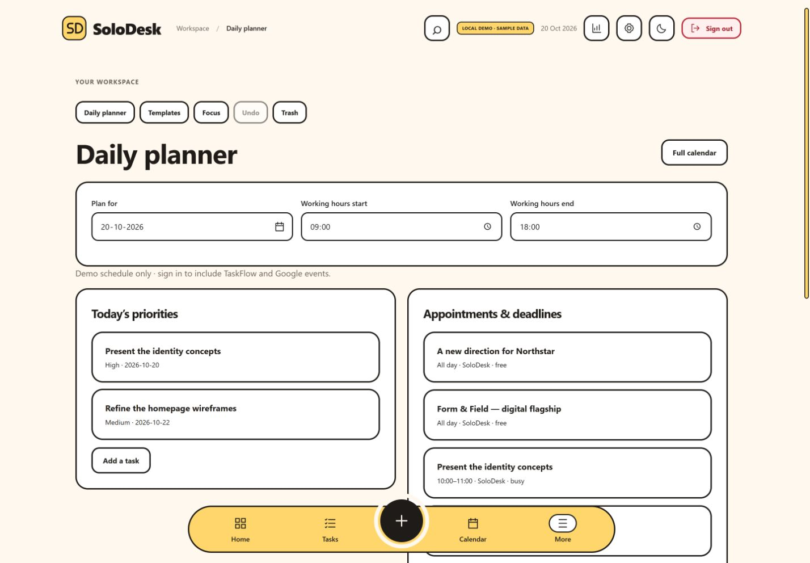
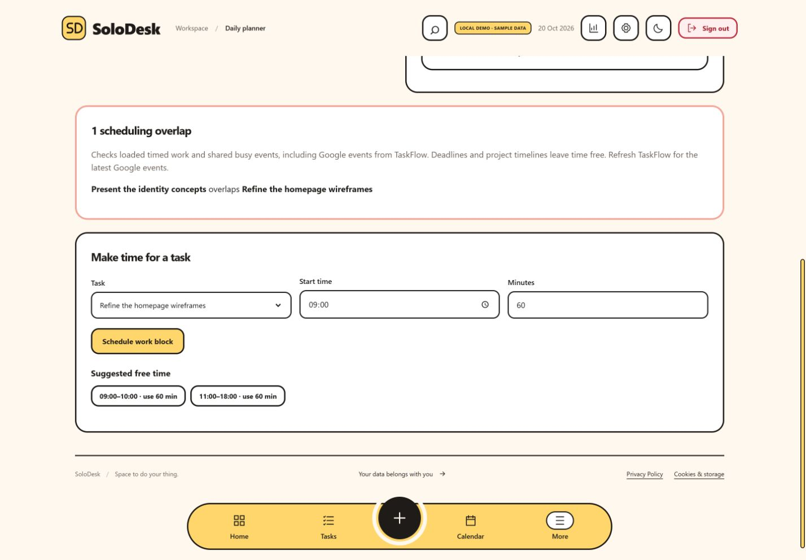
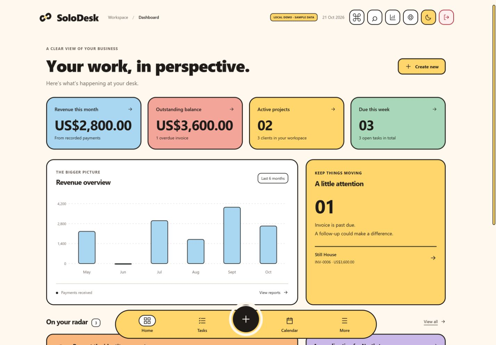
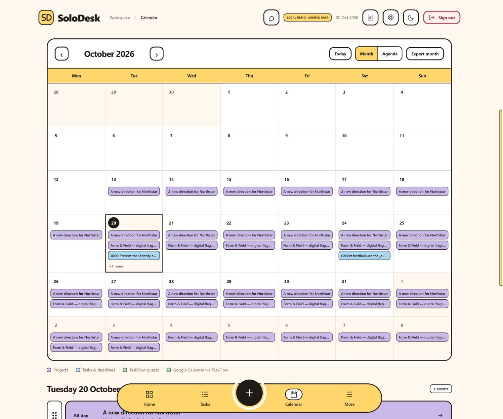
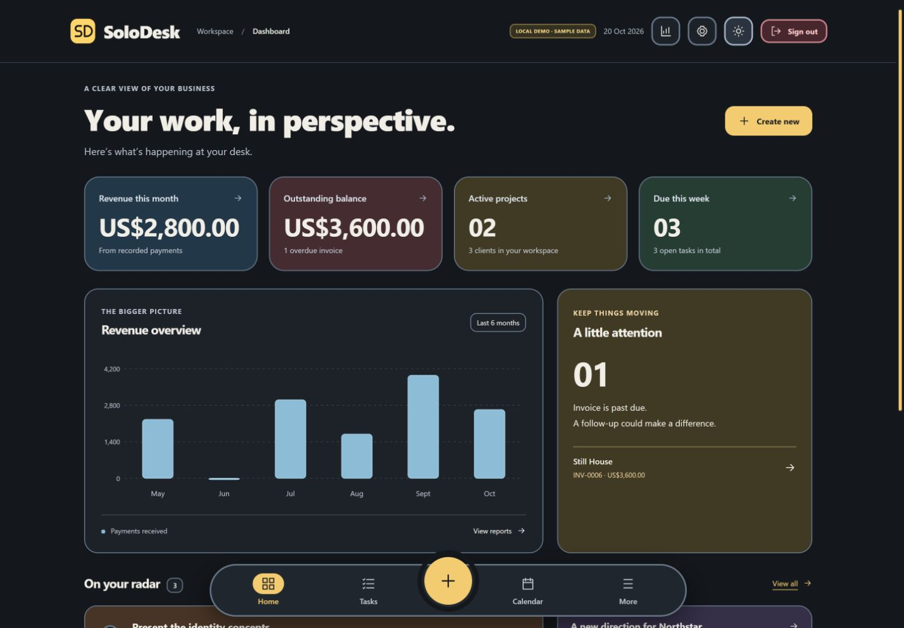
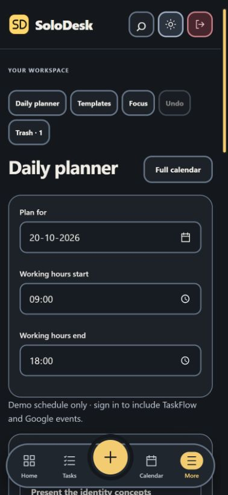
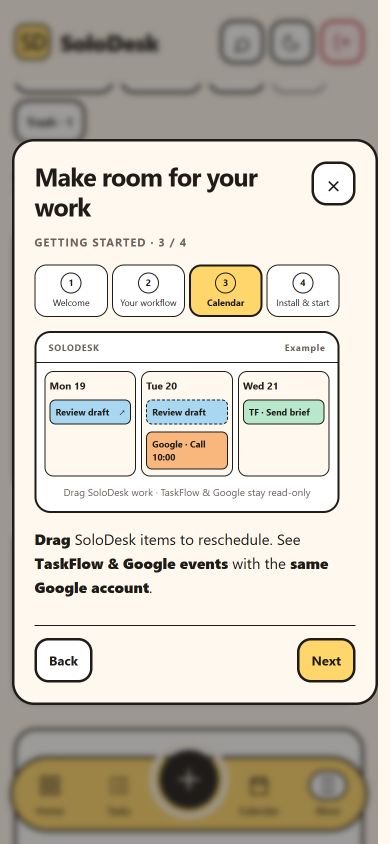

# SoloDesk


**Throughline branding:** [Download the logo and app-icon pack](https://taskflow-solodesk.web.app/brand/solodesk-throughline-brand-kit.zip), or open Settings → Appearance. Includes SVGs, transparent PNG wordmarks, light/dark icons and phone/desktop install sizes. [Verification](qa/throughline-brand-2026-10-21.md).

## Original MVP & credit

SoloDesk builds on the [SoloDesk MVP](https://github.com/nainanijo/Solodesk-MVP), created by [NainaNijo on GitHub](https://github.com/nainanijo).

Big shoutout to her for laying the foundation for this project!

## License

Original contributions by AdityaManojA are available under the [MIT License](LICENSE). The original MVP currently has no published license; inherited code and third-party dependencies are excluded from that grant. See [third-party notices and licensing scope](THIRD_PARTY_NOTICES.md) before reusing the combined application.

A business workspace for independent professionals and studios: clients, projects, tasks, invoices, payments and reports. **Current version: 1.11** ([release notes](CHANGELOG.md), also in the app under Settings → What's new). The interface uses the 1.02 design: a black sidebar, the Terracotta palette (sage, sand, cream) with a per-workspace action colour, Bricolage Grotesque and Figtree type, and a floating dock on phones. The original React/Firebase data model and hash routes are retained. Calendar exports turn project timelines and dated tasks into scheduler events.

## What's new in 1.10

Search finds settings and pages ([`src/settings-index.js`](src/settings-index.js)); the custom action colour was removed. Portal publishing now runs only after the tab's own changes and carries a `wsStamp` (newest change in the workspace) so a stale tab never overwrites a newer portal ([`src/portal-sync.js`](src/portal-sync.js), `workspaceStamp` in [`src/workspace-upgrades.js`](src/workspace-upgrades.js)).

## What's new in 1.09

Approvals for PRDs, files and quotes; client comments, cheers, change requests, link updates, meeting requests and requests with labelled replies ([`src/ClientPortal.jsx`](src/ClientPortal.jsx), [`src/portal-sync.js`](src/portal-sync.js), [`src/client-feed.js`](src/client-feed.js)); a notifications bell ([`src/notifications.js`](src/notifications.js)); quick add (N or Ctrl/⌘ J); invoice unbilled hours ([`src/billing.js`](src/billing.js)); TaskFlow repeats; a redesigned task page and list; and split storage so workspaces can grow past 1 MB ([`src/workspace-store.js`](src/workspace-store.js)). Approval emails are ready for Blaze ([setup](docs/approval-emails-setup.md)).

Deploying 1.09 needs the updated `firestore.rules` (workspace `parts`, portal `comments`, `updates` and `requests`). Copy it to TaskFlow's rules file first so both stay identical, then deploy rules before Hosting.

## What's new in 1.08

Jump back in opens the task, project or client page (notes still open in place) and the revenue card moved off Home ([`src/Home.jsx`](src/Home.jsx)). The calendar's project timeline has a column per day with weekday and date labels, weekend shading, a today line, shared lanes for non-overlapping projects and clearer bar ends ([`src/Calendar.jsx`](src/Calendar.jsx) `WorkTimeline`).

## What's new in 1.07

The client portal header shows the client's name as set in SoloDesk (with initials and the login email) instead of only the email ([`src/ClientPortal.jsx`](src/ClientPortal.jsx)).

## What's new in 1.06

Client portals publish themselves: while SoloDesk is open, [`src/portal-sync.js`](src/portal-sync.js) watches your shares and republishes any whose shared data changed (compared by `portalUpdate` in [`src/workspace-upgrades.js`](src/workspace-upgrades.js), ignoring private fields), about two seconds after the last edit. Ticking what to share under Client access applies instantly. No rules change.

## What's new in 1.05

**Client approvals** — send a task for approval; the client approves or asks for changes in the portal, and answers sync back to the task ([`src/approvals.js`](src/approvals.js), [`src/Approvals.jsx`](src/Approvals.jsx), Approvals page at `#/approvals`). **Client portal** redesigned and extended with project tasks, client links, chosen documents/PRDs and invoices ([`src/ClientPortal.jsx`](src/ClientPortal.jsx); sample at `#/portal-preview`). **Smart typing** ported from TaskFlow's parser: dates, times, clients and projects fill in as you type in tasks, projects, search and checklist items ([`src/smart-parse.js`](src/smart-parse.js), [`src/SmartField.jsx`](src/SmartField.jsx)). Also: clickable breadcrumb, client links, more action colours plus custom, confirm-password fields, completed projects tucked away in pickers, new onboarding.

Deploying 1.05 needs the updated `firestore.rules` (portal `docIds` and the `responses` subcollection for approvals). Copy it to TaskFlow's rules file first so both stay identical, then deploy rules before Hosting.

## What's new in 1.04

Home's "Jump back in" edits your most recently changed notes, tasks, projects and clients in place; TaskFlow quests become a small pill; Apple Notes-style nested checklists ([`src/checklist.js`](src/checklist.js)); a two-pane Notes page; calendar zoom buttons and pinch zoom. Details in [CHANGELOG.md](CHANGELOG.md).

## What's new in 1.03

A rebuilt calendar with Year/Month/Week/Day zoom and a client-by-client project timeline ([`src/Calendar.jsx`](src/Calendar.jsx), layout helpers in [`src/calendar-view.js`](src/calendar-view.js)); Google Keep-style notes and checklists with a Notes page ([`src/NotesKeep.jsx`](src/NotesKeep.jsx)); a profile setup walkthrough; Settings on one scrolling page; a cleaner toolbar and sidebar account area; uniform project cards; palette colours in Reports and TaskFlow items. Details in [CHANGELOG.md](CHANGELOG.md).

## What's new in 1.02

- **New design and action colour** — every page restyled ([`src/theme.css`](src/theme.css)); Settings → Appearance picks the highlight colour ([`src/appearance.js`](src/appearance.js)).
- **Home: Jump back in** — the three most recently edited clients, projects and TaskFlow quests ([`src/recents.js`](src/recents.js)), revenue, needs-attention, mini calendar and today's timeline. **All work** at `#/work`.
- **Notes, checklists and reminders** on every client and project; **project pages** at `#/projects/<id>`.
- **Files & docs** — PRDs written in SoloDesk with requirements that become tasks, plus file links.
- **Live Microsoft Excel sync** per project or client (server code in `functions/excel-*.js`; needs Blaze and a Microsoft app — [setup](docs/excel-sync-setup.md)).
- **Public profile** at `/<username>`, private by default ([`src/profile.js`](src/profile.js); Firestore collection `solodeskProfiles`).
- **Invoice editing on the page** with bank details and defaults; **What's new** in Settings and an update note for returning users.

Deploying 1.02 needs the updated `firestore.rules` (public profiles and Excel sync status). Copy it to TaskFlow's rules file first so both stay identical, then deploy rules before Hosting.

**Status:** frontend deployed to https://taskflow-solodesk.web.app in `taskflow-dailytracker`, separately from TaskFlow’s Hosting site. Version 1.11 (26 October 2026) passes all **164 automated tests** and the production build. TaskFlow quests and its shared Google events are read-only in SoloDesk. Live sign-in/cloud-save round trips still need an account-level check. The standalone integration API and background server functions are not deployed on the Spark plan.

## Shared calendar markers

TaskFlow quests and Google events now have separate dot/count markers on each month date, alongside project and task markers. Click a date or marker to see the full schedule. [Verification and sample screenshot](qa/calendar-shared-sources-2026-10-20.md). **106 tests pass.**

## Calendar and mobile refresh

The header actions now align in one group. Calendar has a selected-day schedule, separate timed work / deadlines / project timelines, a date-grouped agenda, and compact phone month markers. See [checks and screenshots](qa/calendar-refresh-2026-10-20.md). The current automated suite has **105 passing tests**.

## Latest interface cleanup

Settings now use expandable groups, client details have Overview / Work / Invoices / Access sections, and related planning and export tools live together. Filters, calendar choices and scroll positions survive navigation within a session. Less-used screens load separately; the application entry bundle is about 19% smaller. See [verification and screenshots](qa/ui-polish-2026-10-20.md).

## Planning & productivity

New workspace tools include **safe syncing**, **backup/restore**, **Week/Day calendar views**, **task dependencies**, **client email/password portals**, **project budgets**, **notes/checklists**, **dashboard choices**, **commands**, **archive/Trash controls** and **offline recovery**. See [client portal setup](docs/client-portal.md) and [verification & limits](qa/workspace-upgrades-2026-10-20.md). The current suite has **103 passing tests** plus Firebase emulator access tests.

Latest maintenance: [bug and security review — 20 October 2026](qa/security-review-2026-10-20.md). **96 tests and the production build pass**; browser security headers and recovery/focus/save-limit fixes are deployed. The review also records remaining concurrent-editing and account-level verification gaps.

The workspace now includes a **Daily planner**, scheduling **conflicts and free-time suggestions**, a calendar **unscheduled task tray**, **global search** (Ctrl/Command K), **Undo & Trash**, **recurring tasks and invoice drafts**, **project templates with draft invoice milestones**, **client activity timelines**, and a **focus timer with project totals**. Access these from header Commands, search, contextual page links or **More**; task recurrence and focus are also available in task details/editing. No payment follow-up messages were added.

Undo retains 20 changes for the current session; Trash persists in the workspace. Completing a repeating task creates its next occurrence. Recurring invoices require **Generate due drafts** and remain unsent drafts. Focus uses elapsed wall-clock time and logs on Finish. **92 tests and the build pass**; see [verification and limits](qa/productivity-2026-10-20.md).

See the [productivity guide](docs/productivity.md) for where to find each tool and how to use it.

## Screenshots

Captured from the deployed app on **20 October 2026** using **demo data**. [View all 21 screenshots](docs/screenshots/README.md), including nine new views of the planner, templates, search, focus, client timeline, recurring drafts, Trash and scheduling conflicts. Mobile images use simulated phone viewports.

### Daily planner



### Conflicts & free time



### Desktop dashboard



### Calendar



### Dark mode



### Mobile & onboarding

 

## Run locally

Use Node **24.12 or newer** for the existing Firebase 13 browser SDK’s declared engine requirement. This session used Node 22.20: install, build and tests passed, but npm reported Firebase engine warnings. The separate Cloud Functions package targets Node 22.

```powershell
npm ci
npm run dev
npm run test
npm run build
npm run preview
npm run check                 # tests then build
```

These commands were run successfully (the dev/preview scripts keep running). Open the printed local URL. Without Firebase settings, choose **Explore the demo**. Demo data is explicitly marked, stored in this browser only, and never written to Firestore. The session preserves demo mode across reloads; exit using Settings → Sign out or the desktop profile button. Production source is served from `dist/`; do not serve the repository root publicly.

For real data, copy `.env.example` to `.env.local` and enter your Firebase web app configuration. Restart Vite after changing environment variables. Never put a calendar API secret in a `VITE_` variable; browser variables are public.

## Firebase setup and deployment

1. SoloDesk's local `.env.local` uses the supplied TaskFlow web configuration, and `.firebaserc` maps the `solodesk` alias to `taskflow-dailytracker`. Restart Vite after configuration changes; rebuild when using preview.
2. In that Firebase project's Authentication settings, enable Google sign-in and authorize the SoloDesk domain (including `localhost` and `127.0.0.1` when used locally). Ensure a Firestore database exists. SoloDesk stores its workspace in `solodeskWorkspaces/{uid}`; it does not read or overwrite TaskFlow's task collections. Data from the previous Firebase project is not migrated.

   **Shared project rules:** merge the owner-only `solodeskWorkspaces/{uid}` rule from `firestore.rules` into TaskFlow's existing rules. Do not deploy this standalone rules file over TaskFlow's rules: Firebase replaces the complete ruleset. Integration key collections must remain inaccessible to browser clients. SoloDesk's workspace deletion keeps the shared Firebase Authentication account.

   **Hosting:** `firebase.json` uses the named `solodesk` target, mapped in `.firebaserc` to the separate `taskflow-solodesk` site. Deploy only this target to leave TaskFlow's existing site intact. The read-only TaskFlow listener uses the shared account to display quests and calendar events.
3. Install server dependencies in their own directory:

   ```powershell
   Push-Location functions
   npm ci
   Pop-Location
   ```

4. Create `functions/.env.<your-project-id>` from `functions/.env.example`. Set `API_ALLOWED_ORIGINS` to the exact SoloDesk browser origin (comma-separated if needed). Include the actual local origin only when using a deployed API from local development. Empty configuration blocks browser origins; server-to-server requests without Origin still work.
5. With the Firebase CLI installed and signed in, deploy using an explicit project:

   ```powershell
   npm run check
   firebase deploy --project taskflow-dailytracker --only hosting:solodesk
   ```

The frontend-only deployment above completed successfully. The current Hosting configuration serves the SPA and its public policy routes. The server integration API is not deployed; listing functions in this project failed during setup. Before enabling it, confirm runtime/billing prerequisites and function-name isolation, deploy the backend, then add a `/api/**` rewrite to function `api` in `us-central1` ahead of the SPA fallback. Configure `API_ALLOWED_ORIGINS` for the SoloDesk site. In development, set `VITE_API_BASE_URL` to the deployed API origin plus `/api/v1`. A missing API is shown as an actionable error in Integrations. Do not use a blanket functions/rules deployment against this shared project.

After deployment, sign in, save a record, open Integrations, create a calendar-only key and test a subscription or API request from your calendar backend. Do not mark cloud integration complete until that succeeds.

## TaskFlow live connection (Spark plan)

The shared Firestore rules were copied exactly from `D:/Projects/TaskFlow-controls/firestore.rules` and deployed first. Always preserve both apps' owner-only rule blocks. SoloDesk owns rules deployment; TaskFlow's copy must stay identical. Function codebases remain `default` (SoloDesk) and `taskflow` (TaskFlow), and neither was deployed.

`src/useTaskflow.js` attaches one read-only `onSnapshot` listener to `taskflowUsers/{uid}/share/open` for the signed-in user. It unsubscribes and clears the view on account change, sign-out or demo mode. SoloDesk never reads chunks and never writes under `taskflowUsers/`. Incoming records stay outside the SoloDesk workspace and are not saved back to Firestore. Loading, missing-document, empty, cached and permission/network error states are distinct; errors offer retry.

Tasks has a **From TaskFlow** list including undated quests, P1–P6, notes, repeat labels and subtask completion. Calendar merges dated quests and shared calendar events, with source labels, a TaskFlow-only filter and source links instead of edit controls. Client filters hide unlinked TaskFlow records. Due times use TaskFlow's timezone; missing/invalid timezone or nonexistent daylight-saving times fall back to an all-day reminder with an explanation. Due times are reminders, not scheduled work blocks. Repeat labels are shown but future occurrences are not invented: TaskFlow owns each quest's next due date. Shared calendar all-day end dates stay exclusive. Calendar month/event downloads include displayed items; other workspace exports remain SoloDesk-only.

This connection runs entirely in the browser on Spark; no function or API key is needed. Google events appear only when TaskFlow shares them. SoloDesk's optional server API and direct Google/Apple syncing remain unavailable on the current deployment.

Validation: 34 automated tests and the production build passed, including schema handling, timezone/DST conversion, malformed events, safe links, date boundaries and exports. A real same-account round trip must also be checked by creating a dated quest in TaskFlow while SoloDesk is open.

## Pages and behavior

Brand assets: SoloDesk uses an SD monogram in a warm-yellow tile, paired with its wordmark. Shared `src/BrandLogo.jsx` renders it in the app header, login and policy pages. Reusable transparent SVGs are in `public/brand/`: `solodesk-mark.svg`, `solodesk-logo.svg` and `solodesk-logo-dark.svg`. The mark is also the browser favicon. Logo changes do not replace business logos uploaded for invoices. Production build and local light/dark appearance were checked.

Deletion and sign-out: red actions are available for clients, projects, tasks, all invoice states and individual payments, with explicit confirmation. Deleting a project keeps and unlinks its tasks. Deleting a client explicitly confirms cascading removal of its linked projects, tasks, invoices and payments. Deleting invoices/payments recalculates reports from the remaining records. TaskFlow remains read-only. Settings retains the full-workspace delete action and the shared Firebase account is kept. Sign-out is available in the header and Settings, clears demo/auth state, and returns to `/` with the Google login screen. Unsaved changes offer an explicit sign-out-anyway option instead of blocking exit. In-flight old workspace loads cannot repopulate the UI after account changes. Validated with 39 automated tests, a production build, browser confirmation/cancel checks and demo sign-out; real-account cloud deletion/sign-out was not exercised in this change.

Form controls share `src/Controls.jsx` and `src/controls.css`. Date fields expose a themed month picker with date limits, keyboard navigation and Today/Clear controls where applicable. Dropdowns use themed option panels with type-ahead, arrow keys and Escape; native form values remain available to submission and validation. Settings uses a themed file-upload surface; the operating system's file chooser remains native. The same controls are used in reports, calendar filters, project/task/invoice dialogs and integrations. Verified in the browser: light/dark calendar appearance, report date selection by mouse and keyboard, currency selection and persistence after Settings submission, and Escape closing nested controls without dismissing the task dialog. Mobile/browser combinations and assistive technologies have not received a full audit.

Dark mode uses a dedicated palette in `src/dark.css`: graphite surfaces, restrained semantic tints, amber actions, visible form borders and blue focus indicators. It covers navigation, dashboard, forms/dropdowns, calendar, statuses, integrations, login, policy pages and invoice previews; print styling keeps invoices on white paper. Light mode retains the existing palette. Verified locally on the dashboard, calendar controls, new-task dialog and invoice preview; this is not a full accessibility certification.

Public policy pages are available at `/privacy` and `/cookies` (also `#/privacy` and `#/cookies`) without authentication. Links appear on the sign-in screen and workspace footer. Their contact email is configured using `VITE_POLICY_CONTACT_EMAIL`; optional `VITE_POLICY_OPERATOR_NAME` supplies the operator name. Rebuild after changing these public values. The pages describe current data handling, the shared TaskFlow Firebase account, deletion limits and actual browser storage. The cookies page can clear local demo data without deleting cloud records. Update these disclosures whenever trackers, integrations or retention practices change.

| Route | What it does |
| --- | --- |
| `#/dash` | Revenue, outstanding invoices, upcoming work, project progress and attention items |
| `#/clients`, `#/clients/:id` | Search, create/edit/archive/restore clients; related projects, tasks and invoices |
| `#/projects` | Search/filter projects; edit status and optional timeline dates |
| `#/tasks`, `#/tasks/:id` | Status/client/project/date filters; edit, complete/reopen and delete tasks; optional timed scheduling |
| `#/invoices`, `#/invoices/:id` | Status filter, draft editor, line items/tax, mark sent, record partial/full payment, void/reissue, printable invoice |
| `#/reports` | Payment-date revenue range, chart and table; outstanding balance |
| `#/calendar` | Full month/agenda calendar; client/type/completed filters; event details/editing; monthly and individual ICS export |
| `#/integrations` | Calendar preview/range, ICS and JSON events, all-data JSON, CSVs, scoped key management and API examples |
| `#/settings` | Business details, currency, logo, payment instructions, CSVs and account actions |
| `#/more` | Mobile access to projects, reports, integrations and settings |

Hash routing retains browser history. A sticky header and TaskFlow-style floating bottom dock stay available on desktop and mobile. More exposes clients, projects, invoices, reports, integrations and settings. CSS handles page entry, hover/focus, chart and dialog transitions. Native scrolling and native selects preserve keyboard behavior. Dialogs trap focus, close with Escape, lock background scrolling and restore focus. Forms retain required/type/range validation. Google login and existing invoice state rules are retained. Invoice PDF uses the browser’s Print → Save as PDF flow.

Cloud writes are queued to preserve order within one browser session. The top bar shows saving/error state and retries the latest complete workspace. Unsaved changes warn on tab close and prevent sign-out. This remains a single-document workspace with last-writer-wins behavior across multiple tabs/devices; there is no realtime conflict merging or offline write queue. Live failure/retry behavior and destructive account deletion have not been exercised against a cloud account.

## Fill a calendar or scheduler

See [the complete API and sync guide](docs/calendar-api.md) and [the server-side pull helper](examples/pull-calendar.mjs).

- Add Start/End dates to projects for timeline spans.
- Add Scheduled start and Duration to tasks for timed work blocks. Input uses the device timezone; storage and JSON use UTC.
- Tasks with only Due date become all-day deadline reminders. Undated work and completed work are excluded by default.
- Project spans and all-day reminders show availability as free. Timed tasks reserve busy time.
- Integrations → **Export calendar · ICS** works immediately as a file import. **Export events · JSON** supplies stable IDs and client/project context.
- After deployment, create a **Calendar events only** key for `GET /api/v1/calendar` or the private `/api/v1/calendar.ics?key=...` subscription URL. Keys expire in 90 days and can be revoked. Calendar-only access excludes financial records and private client details.
- Custom scheduler: fetch every page, upsert by event ID, then reconcile missing SoloDesk events only after a complete successful refresh. A multi-page fetch is not an atomic snapshot. The example helper fetches to a file; it does not send to a calendar provider.

This is one-way import/subscription/polling. Provider-specific OAuth, two-way editing, webhooks, recurring tasks and automatic scheduling/conflict resolution are not included. Refresh timing for subscriptions belongs to the calendar provider. Revoke a key to stop future reads; already imported copies remain in the other app.

## Files and dependencies

| File | Purpose |
| --- | --- |
| `src/App.jsx` | App shell, routes, Firebase loading/saves, existing business pages and dialogs |
| `src/styles.css`, `src/taskflow.css` | Shared layouts and the TaskFlow palette, type, outlines, responsive controls, motion and print styling |
| `src/Calendar.jsx`, `src/calendar-view.js` | Full month/agenda view, selected-day timeline, per-event exports and local-date grid helpers |
| `src/Icon.jsx`, `src/demo.js` | Local inline SVG UI icons; explicitly fictional demo records |
| `src/Integrations.jsx` | Timeline/export UI and key management |
| `src/firebase.js` | Optional initialization from local environment |
| `src/lib.js` | Invoice maths/status, reports, CSV escaping/exports, download and legacy text PDF helper |
| `functions/index.js`, `functions/api.js` | Firebase HTTP adapter and authenticated read-only API |
| `functions/calendar.js` | Shared event mapping and RFC 5545 calendar serialization |
| `functions/*.test.js` | API auth/isolation, calendar/ICS, CSV and calculation tests |
| `qa/responsive.html` | Dev-only 320/390/768/1440px frame for manual review; not part of the Vite production entry |
| `qa/screenshots/` | Actual local browser screenshots using sample data |
| `firestore.rules` | Original owner-only workspace rule; unmatched key collections remain denied to clients |

Existing browser dependencies retained: React/React DOM **18.3.1**, Firebase **13.0.0**, Vite **8.3.4**, React plugin **6.1.2**. New server dependencies: Firebase Admin **14.5.0** and Firebase Functions **7.4.0** (locked in `functions/package-lock.json`) for verified authentication and server-only key/storage access. Build chunks separate React, auth and Firestore for caching. No animation, charting, icon or external font packages were added.

## Design and assets

The supplied `anti-SLOP.md` informed the initial overhaul and remains useful for accessibility, restrained CSS motion and honest verification. The later explicit TaskFlow reference takes precedence over the earlier navy/neutral direction.

TaskFlow reference source: `D:/Projects/TaskFlow/design/DESIGN_BRIEF.md` and `design/prototype/index.html`. Applied palette: cream `#FFF8EE`, ink `#1E1B18`, mint `#A8D8B9`, coral `#F4A59A`, lavender `#C9B8E8`, butter `#FFD66B`, sky `#A9D6F0`; flat surfaces, 2.5px outlines and generous rounded corners. The dock uses four destinations and a raised central Create button. No TaskFlow mascot, sounds, art or source files were copied or modified. The UI retains SoloDesk’s existing three task priority levels. Typography uses local Inter when available, with Segoe UI/system fallbacks; no remote font is fetched.

[Prompt Motion](https://prompt-motion.com/) and [SiteInspire](https://www.siteinspire.com/) were reviewed during the initial design pass; no assets or copied components were used. No animation/chart/icon packages were added. Icons are local inline SVG paths; stock photography, analytics and tracking were not introduced. Existing dependency licenses remain applicable.

## Verification — 19 October 2026

See [the detailed functional review](qa/functional-review-2026-10-19.md) and [recorded browser assertions](qa/browser-checks.json).

- `npm run check`: **27 automated tests passed**, production build passed. Includes API isolation/key scope/lifecycle, calendar date/UTC/ICS behavior, month navigation/leap days, CSV protection, invoice calculation agreement and overdue-invoice reissue regression. Backend tests use fake repositories, not live Firebase.
- **32 browser assertions passed** in the local demo, plus downloads inspected. Clients, projects, task scheduling/filters, invoice lifecycle, report totals, settings/logo, calendar filters, navigation and create shortcuts were exercised. Permanent deletion confirmations were canceled.
- Download contents verified: all 5 CSV types, workspace JSON, 6-event calendar JSON/ICS and one-event ICS. Native date input was used to verify controlled report/date-filter changes.
- Responsive review: 320/390/768px iframe viewports and desktop; light/dark appearance. The phone currency wrapping defect was corrected. Not a complete device matrix or automated visual regression suite.
- Pending: live Firebase login/writes, deployed API/key-management UI, provider-side Google/Apple imports/subscriptions, actual PDF save, permanent deletion and cloud/network failures. No performance/accessibility certification is claimed.

## Release checklist

### Build and handoff

- [x] DONE — Setup/run/build/test commands and routes documented; build and 27 tests passed.
- [x] DONE — Dependencies, references, local assets and implementation choices recorded.
- [x] DONE — Primary demo navigation/forms and documented states manually checked; untested flows listed above.
- [x] DONE — Representative mobile/tablet/desktop layouts inspected; scope of review recorded.
- [x] DONE — Labels, focus styles, focus trap/restore, Escape and reduced-motion rules implemented and reviewed in source; dialogs and dropdowns exercised. Full keyboard/screen-reader audit remains pending.
- [x] DONE — Console/build/test results recorded only for checks actually run.
- [x] DONE — Known limitations and owner actions recorded.

### SEO and search readiness

- [x] DONE — Route-specific titles, accurate app description, semantic landmarks and descriptive links added. Primary business-page headings are h1.
- N/A — Indexable marketing content, canonical URLs, sitemap, structured data and social previews: this is a private workspace, not a marketing site. No production domain was guessed. `noindex,nofollow` is intentional and is not an access-control mechanism.
- N/A — Meaningful website images: no editorial images introduced. Uploaded invoice logos retain existing treatment.
- [ ] PENDING — Owner must review deployed redirects/404 and crawler behavior. Hash routes intentionally fall back to the SPA dashboard for unknown top-level routes; missing records show a recovery link.
- [ ] PENDING — Core Web Vitals/performance measurements on a representative deployment. No rankings or indexing outcomes promised.

### Google Search Console

- N/A — Workspace domain/property, ownership verification, sitemap submission and URL indexing: search indexing is intentionally disabled. Revisit only if a separate public marketing site is launched.

### Privacy, cookies and consent

- [x] DONE — No analytics, ads or nonessential tracking added. Local demo data/theme use localStorage; demo activation uses sessionStorage. Firebase retains its existing authentication persistence when configured.
- [x] DONE — Data export tools, key scope/expiry/revocation and private subscription URL guidance implemented.
- [ ] PENDING — Owner’s privacy notice, real data retention/deletion policy (including integration-key metadata and cloud logs), processor disclosures and incident process. Demo text is not a privacy policy.
- [ ] PENDING — Review actual deployed cookies/storage, authentication providers, jurisdictions and any required consent mechanism. No blanket cookie/legal compliance is claimed.

### Applicable legal and operational launch checks

- [ ] PENDING — Business identity, jurisdiction-specific invoice/tax requirements, terms, privacy/cookie notices and content rights need owner review. No legal documents or business claims were invented.
- [ ] PENDING — Configure Firebase and allowed origins; deploy the correct project; verify live authentication, isolation, saves, exported records, key lifecycle and provider subscription.
- [ ] PENDING — Confirm operational monitoring, quotas, key rotation, log retention, account-deletion cleanup and backups before production use.
- [ ] PENDING — Connect the actual calendar application; its provider/API details were not supplied. The neutral JSON/ICS interface is implemented.

## Opening the full calendar and exporting individual work

Google Calendar through TaskFlow: shared Google events appear alongside quests and SoloDesk work in Month and Agenda. Use **All clients** and **All calendars & work**, or select **Google Calendar via TaskFlow**. Event priorities, locations and busy times are retained. Connect Google and use **Sync now** in TaskFlow with the same Google account. TaskFlow currently publishes the primary calendar from 7 days back to 62 days ahead; SoloDesk cannot refresh Google's API itself. **71 tests/build pass**; see [Google feed verification](qa/taskflow-google-2026-10-20.md).

Onboarding update (20 October 2026): a one-time top **Add to Home Screen** banner opens installation guidance, and a four-step first-run introduction offers installation again on its final step. An eight-step guided tour highlights actual screens on desktop and mobile. Replay either from **Settings** or **More**. Completion/skip preferences are local to this browser, separated by signed-in account and demo. **69 tests and production build pass**; see [onboarding verification](qa/onboarding-2026-10-20.md).

Continued review: **67 tests/build pass**. Browser export date ranges now use local-day boundaries, and cloud save queues are isolated by sign-in session to prevent stale status and blocked writes across accounts. See [continued review and remaining checks](qa/continued-review-2026-10-20.md).

Scrollbars now match the cream/ink/yellow theme and its dark variant across pages, dialogs and dropdowns while retaining native scrolling. See [scrollbar verification](qa/scrollbars-2026-10-20.md).

**Add to Home Screen** is available on login, Settings and More. Supporting browsers can show a native install prompt; iOS and other browsers get platform-specific instructions. A web manifest, desktop/Android PNGs, maskable icon and Apple touch icon enable standalone launches. No service worker or offline workspace cache is introduced. See [installation verification](qa/install-2026-10-20.md); 61 tests/build pass, with real OS/device installation still pending.

Calendar rescheduling/mobile update (20 October 2026): drag SoloDesk tasks or project spans onto another visible date, or open event details and use **Move to date**. Task times/duration and project lengths are preserved. TaskFlow items stay read-only. Shared phone layouts, forms, touch targets and overlay clearance were improved. **54 tests/build pass**, with 60 page/width layout observations and real browser drag checks; see [calendar/mobile verification](qa/calendar-mobile-2026-10-20.md) for exact scope and device-testing limits.

TaskFlow quest cards and their calendar entries now use the six priority colors from `D:/Projects/TaskFlow-controls/app/css/app.css`: P1 coral `#F4918A`, P2 orange `#F9B77E`, P3 yellow `#FFE08A`, P4 mint `#B9E7CC`, P5 sky `#A9D6F0`, P6 lilac `#D4C4F2`. Dark mode uses corresponding dark surfaces and pastel borders. Priority labels remain visible. Verified all six rendered card colors in light/dark mode and a 320px viewport using a local sample-data fixture, without reading or writing an account.

Latest invoice/client verification (20 October 2026): **47 automated tests and production build pass**. Invoices support inline **+ New client** without losing the draft. Multiple new clients, repeat invoices for an existing client, draft editing, reload persistence and partial-payment arithmetic were checked in the local demo. See [invoice/client review](qa/invoice-client-2026-10-20.md) for scope and remaining cloud checks. Use the red **Sign out** button in the header or Settings → Account to leave demo and return to Google login.

Start `npm run dev`, open the printed local URL and choose **Calendar** in the floating bottom dock. Month shows a full six-week grid; Agenda lists the month’s work. Select a date for its full agenda, or filter by client/type. Open an event to edit it or choose **Export this event · ICS**. **Export month** exports events overlapping the displayed month with the current filters. The Integrations page also links to the full calendar and includes Google/Apple setup instructions.

Only dated tasks and projects become calendar entries. Clients are event context; invoices/payments remain financial records rather than calendar events. Native Google OAuth, Apple calendar writes and two-way sync are not implemented. Use file imports for separate copies, or the deployed ICS subscription for ongoing one-way updates.
