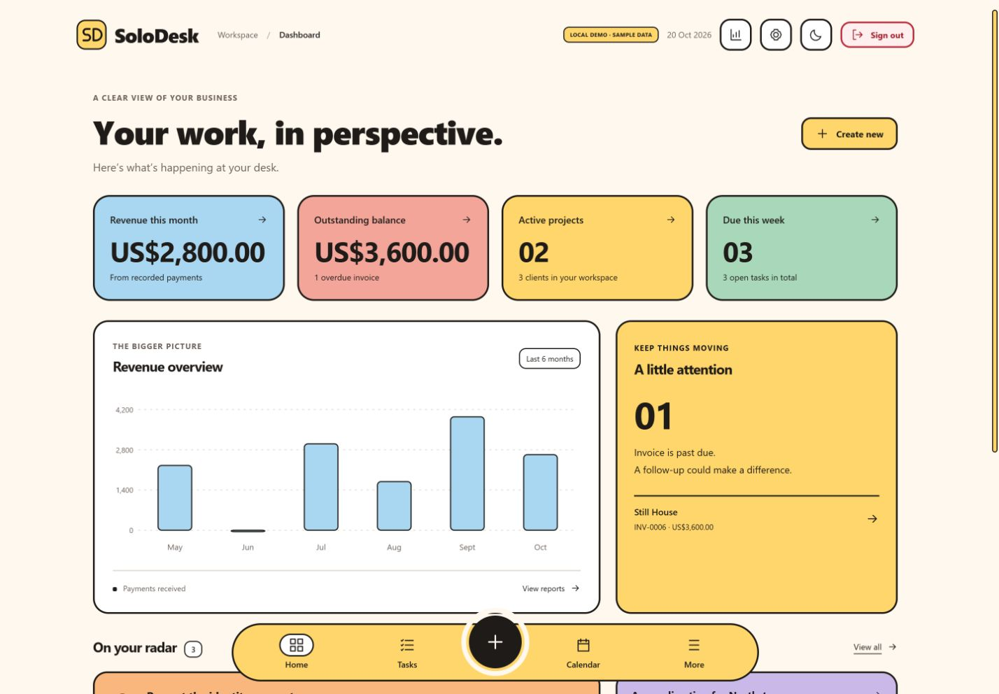

# SoloDesk screenshots

Captured from the deployed app on 20 October 2026 using **local demo/sample data**. These images do not show a signed-in user's workspace. Mobile captures use a simulated phone viewport.

| Screenshot | Viewport |
| --- | --- |
| [Sign-in page](01-sign-in-desktop.png) | 1440 × 1000 |
| [Dashboard](02-dashboard-desktop.png) | 1440 × 1000 |
| [Projects](03-projects-desktop.png) | 1440 × 1000 |
| [Full-month calendar](04-calendar-desktop.png) | 1440 × 1200 |
| [Invoices](05-invoices-desktop.png) | 1440 × 1000 |
| [Reports](06-reports-desktop.png) | 1440 × 1200 |
| [Dashboard — dark mode](07-dashboard-dark.png) | 1440 × 1000 |
| [Dashboard — mobile](08-dashboard-mobile.png) | 390 × 844 |
| [Tasks — mobile](09-tasks-mobile.png) | 390 × 844 |
| [Calendar agenda — mobile](10-calendar-mobile.png) | 390 × 1000 |
| [Visual onboarding — mobile](11-onboarding-mobile.png) | 390 × 844 |
| [Guided tour](12-guided-tour-desktop.png) | 1440 × 1000 |

## Preview




## Copy into the main README

These paths are relative to the repository root:

```markdown
## Screenshots


```
