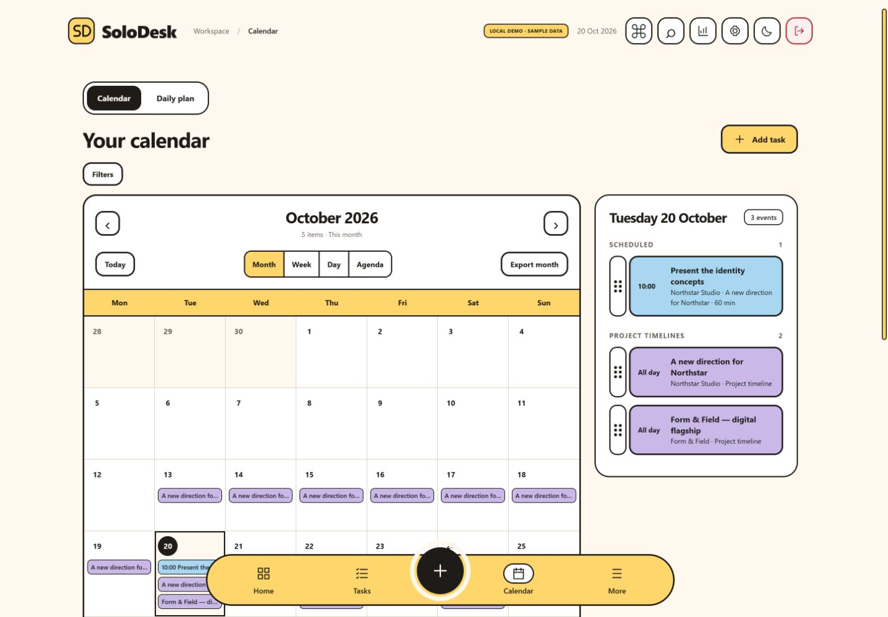
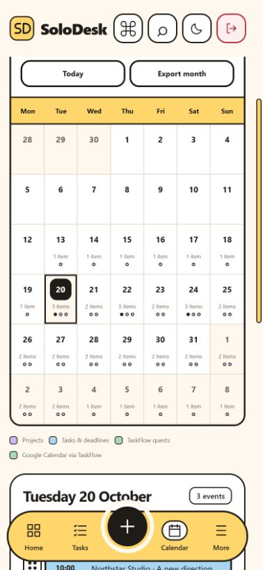
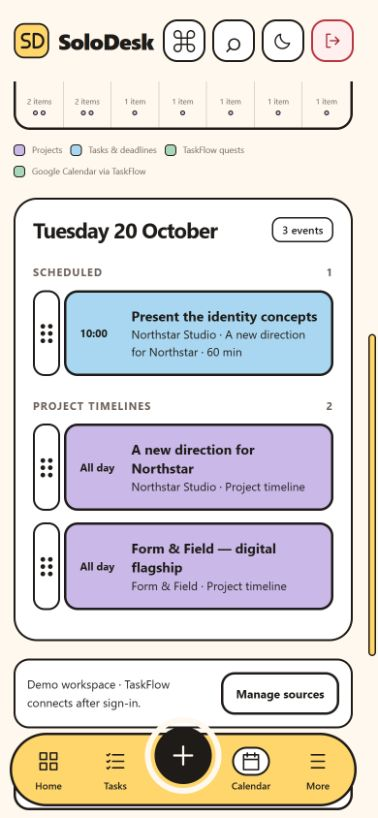
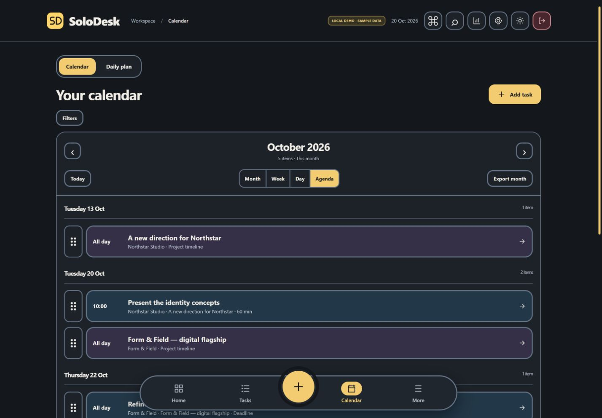

# Header and calendar refresh - 20 October 2026

## What changed

- Header Commands, Search, Reports, Settings, theme and sign-out now share one action group. Desktop controls are 44x44 with the same top position and spacing. Phone layouts keep four actions and use the existing More menu for other screens.
- Calendar Month, Week, Day and Agenda retain the existing sources, exports and editing actions.
- Month cells sort timed appointments before deadlines and project spans. A selected-day panel separates Scheduled, Deadlines & all-day, and Project timelines; it sits alongside the grid on wider screens and below it on phones.
- Mobile month cells show counts and source markers; tapping a date brings its readable daily schedule into view. Existing drag handles remain on daily rows and hourly cells. The week grid scrolls inside its own container.
- Agenda groups records by local start date and lists a continuing project once, anchored at the first visible month date if it started earlier. Export data is unchanged.
- Filters and source guidance are expandable to keep the calendar near the top.

## Checks

- 105 automated tests and production build passed, including new chronological sorting / date grouping checks.
- Offline shell check passed; API and authentication traffic remain outside the cache.
- Preview browser: all four calendar modes at 320px wide; internal week grid width 670px with a 275px scroller and no page overflow.
- At 320x568, Clients, Projects, Invoices, Reports, Notes, Focus, Connections and Settings each measured document width 308px, within the viewport. This is a route-level layout check, not exhaustive testing of every form.
- Header geometry at 1440px: all six controls were 44x44 at the same top position. At 390px the four visible actions were 44x44; at 320px they were 38x42 with identical alignment.
- Phone date selection opened the selected schedule. Dark agenda and mobile event inspector checked; inspector width 354px in a 390px viewport. Browser warning/error log was empty during the checks.
- No real workspace data, Google sign-ins, TaskFlow records or client permissions were changed. Physical-device touch interactions and screen readers were not tested.
- Only SoloDesk Hosting is released; Firestore rules and functions are unchanged.

## Screenshots

