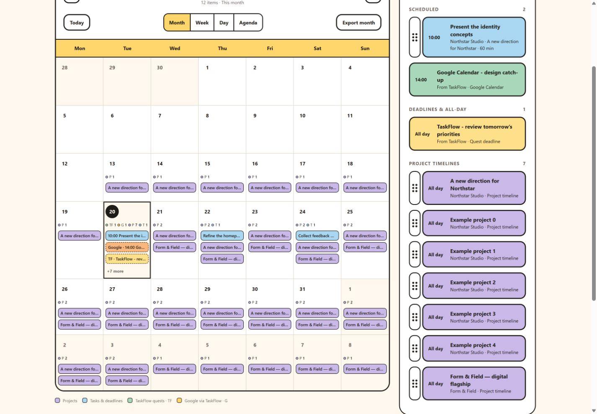

# Shared calendar source markers - 20 October 2026

TaskFlow and Google events already join SoloDesk's calendar event list through the signed-in user's read-only TaskFlow share. This update makes each source visible in crowded month cells, regardless of the three-title preview limit.

- Each date has separate TaskFlow (TF), Google (G), project (P) and task (T) counts. Phones use small colored dots and counts with accessible source labels.
- Click a date, its source markers, or its additional-item count to show the full selected-day schedule. Mobile selection scrolls to the schedule.
- Shared Google events remain timed appointments or all-day events; TaskFlow quests remain deadlines. Source details and read-only source links are retained.
- Filters still apply: select All clients and All calendars & work to include every shared source. Quests need a due date. Google events must be present in TaskFlow's shared feed; this release does not add a direct Google connection.

## Verification

106 automated tests and production build pass, including a test that counts shared sources beyond crowded title previews. Offline-shell checks pass.

The local development fixture `qa/calendar-sources.html` renders the real Calendar component with synthetic data only: one TaskFlow quest, one Google appointment, seven project spans and one SoloDesk task on the same date. Clicking markers switched the selected date and exposed all ten records, including both shared records. At 320px wide the document measured 305px with both shared rows present. No real Firebase documents or accounts were modified. The fixture is not an entry in the production build.

Live feed completeness and the user's connected Google calendar were not verified with a real account. Firestore rules, functions and TaskFlow writes are unchanged; deploy SoloDesk Hosting only.
