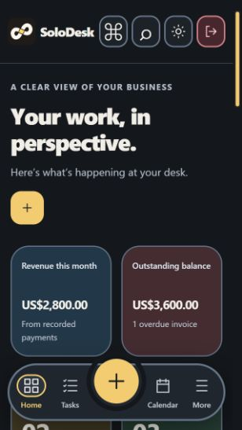

# Throughline brand rollout - 21 October 2026

The owner selected the second Throughline concept. Its connected ink ribbon and yellow joining segment have been rebuilt as clean scalable vector paths.

## Coverage

- Shared BrandLogo/BrandMark: header, sign-in, legal and portal surfaces, onboarding previews and Add to Home Screen/install prompts. Light/dark marks follow the app theme.
- Browser SVG/32px favicon, Apple 180px touch icon, 192/512px desktop/Android app icons and a maskable icon with a padded safe area. App identity and start URL stay the same.
- Compatibility copies at the previous icon URLs now contain Throughline as well; active references use fresh Throughline asset names.
- Transparent PNG and SVG wordmarks/symbols, 1024px app icons, a social/share card, and a ZIP brand kit. Downloads are under Settings > Appearance and linked from README.
- README logo and featured dashboard screenshot refreshed. Older dated QA screenshots remain historical evidence.
- User-uploaded business logos on invoices are unchanged; CSV/JSON/ICS data exports do not contain an app logo.

## Checks

106 tests passed and production build passed. Offline-shell checks passed after including the new light/dark mark and installation icons. Manifest icon dimensions and PNG sizes were inspected; the ZIP archive passed integrity checking.

Production preview browser checks: sign-in logo, onboarding install step, theme switching to the dark mark, Settings download links and clicking Download logo pack. Browser warning/error log empty. At 320px, page width was 308px and header mark 37px. No real Firebase data or account settings were changed.

The OS install dialog/desktop launcher itself was not installed or changed during QA. Existing installations and pinned shortcuts may cache icons; re-adding a shortcut is the reliable way to refresh it. Hosting only is deployed; Firestore rules and backend functions are unchanged.

Generate SVG/PNG assets with `node qa/generate-throughline.cjs <path-to-sharp>`. `qa/generate-install-icons.cjs` is a compatibility entry point. The ZIP contains generated SVG/PNG files and the usage README. SVG wordmarks use Segoe UI/Arial; the symbol is entirely path geometry.

