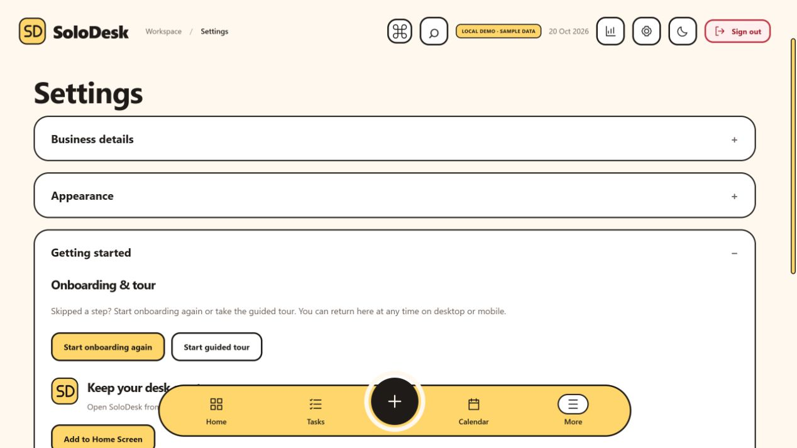
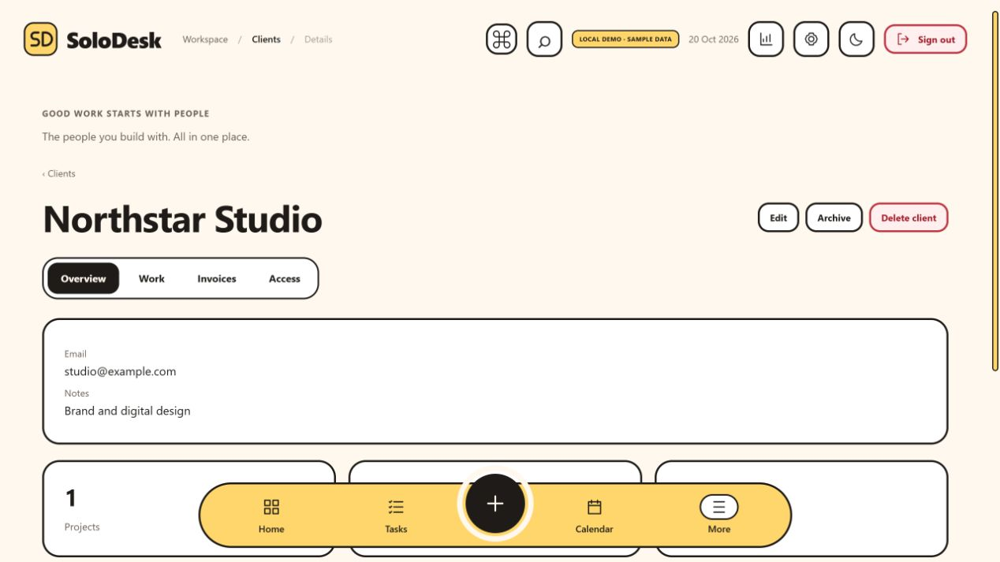
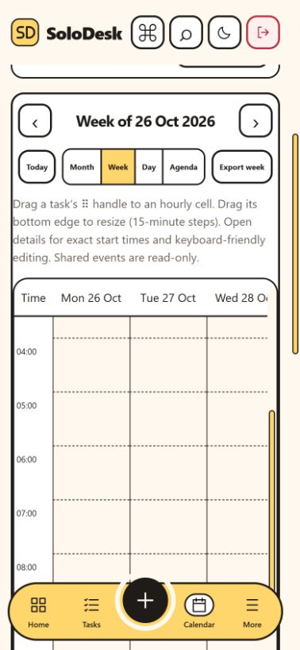

# Interface cleanup - 20 October 2026

This release preserves SoloDesk's cream, ink and pastel theme while reducing repeated controls and page clutter.

## Changes

- Header Commands replaces the repeated workspace toolbar. More groups the remaining tools, with Undo and Trash under Recovery.
- Projects owns Templates; Invoices owns Recurring drafts. Calendar and Daily plan share a local navigation row. Connections and Backup & restore share another.
- Client pages have Overview, Work, Invoices and Access sections. Activity is expandable; portal permissions remain in Access.
- Settings groups Business details, Appearance, Getting started, Data & connections and Account. Replay onboarding/tour is under Getting started.
- CSV exports live alongside JSON backup/restore. Calendar sources use a compact status row; advanced API tools and external-calendar instructions are expandable.
- Calendar period navigation and exports follow Month, Week or Day. Filters collapse on phones by default. Unscheduled tasks appear only when present.
- List preferences, client section and calendar choices remain in account-scoped memory across routes; sign-out/reload resets view preferences. Window and hourly-grid scroll restoration is included.
- Page transitions use a short opacity change without transforming fixed overlays. Reduced-motion styling is retained.
- Calendar, connections, client portal and secondary tools load in separate chunks, with loading and recovery states.
- Calendar event filtering/indexing and search/activity lookups avoid repeated work.

## Verification

- `npm run check`: 103 tests passed; production build passed.
- `node qa/offline-shell.mjs`: generated offline shell/cache checks passed.
- Production preview browser checks in demo mode: all eight tour steps, replay from Settings, grouped settings, client Overview/Access, Commands focus, consolidated backup/CSV controls, collapsed advanced connections.
- A client search returned only Northstar after opening its detail and returning to the list. Calendar retained Week and the week of 26 October after Daily plan and back. The hourly grid retained scrollTop 440 across route changes.
- Phone layouts checked at 320x568 and 390x844: document width stayed within viewport; the week grid scrolls internally. Desktop checked at 1440x1000.
- Screenshots below use sample data. No real accounts or client permissions were modified during browser checks.
- Application entry JavaScript changed from 230.87 kB to 186.03 kB (about 19% smaller; gzip 67.33 to 55.05 kB). This measures the entry chunk, not total downloads or observed load time. Firebase vendor code is unchanged; offline precaching still includes route chunks.

## Limits

Physical phones, screen readers and a network-speed benchmark were not tested. Real Google sign-in/cloud-save and TaskFlow account round trips were not repeated for this interface-only release. Firestore rules, Auth configuration and functions are unchanged. Only SoloDesk Hosting is deployed.

## Screenshots

